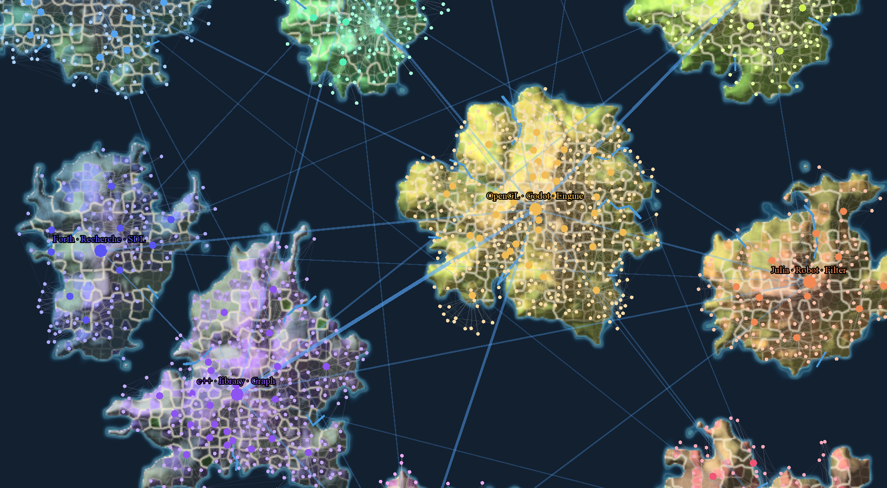
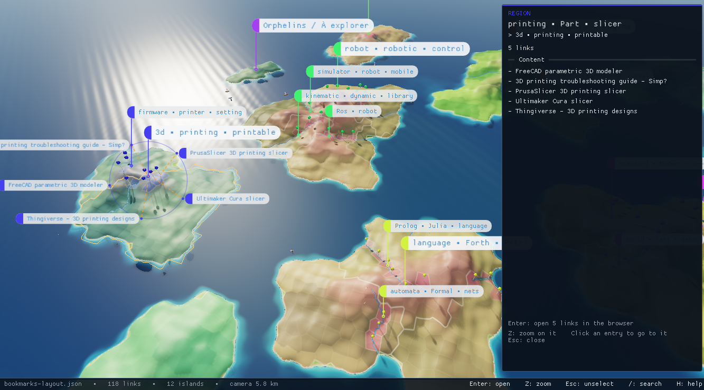
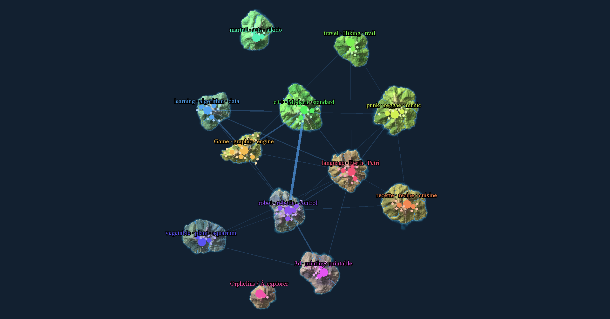

# 🏝️ Islanded Browser

[Islanded Browser](https://github.com/Lecrapouille/IslandedBrowser) was a personal prototype for the [Stigmee](https://github.com/stigmee) for displaying your browser (Firefox) bookmarks as an 3D island.



Note: Since Stigmee is discontinued, you can find a 3D example for testing my 3D renderer [Compages](https://github.com/Lecrapouille/Compages) based on this repo. The current repo is based on exporting bookmarks and making the layout.


Notes:

- I wrote *bookmarks* not *tabs* because it seems that I'm the only guy that never have 500 tabs opened in my browser.
- At contrary I have so many unorganized bookmarks (no folders). Currently the algorithm for organizing does coarse work to make hierarchy island > regions > Voronoï cells. The main goal of this project was to create island from bookmarks.
- I used Firefox, I do not use Chrome browser but I guess the process is identical.
- A [Youtube tutorial](https://youtu.be/_IjCipUK8Bk) shows an older version of the project.

## 📸 Screenshots

There is one program, `IslandedBrowser`, and what it draws depends on the JSON file it is given:

- a **Firefox bookmark file** (`private/bookmarks.json` written by step 1, or `bookmarks/example.json`) is drawn with its original Firefox folders (left): here, a few catch-all folders;
- an **organization file** (`private/organization.json` written by step 2, `organize.py`) is drawn as islands (middle): one island per subject, communities inside each island, and blue rivers between related islands;
- with `--terrain` (or the `T` key), real land is grown under the graph (right): coasts, relief shaped by erosion, one region of Voronoi cells per community, and rivers.

The three pictures show the same 118 bookmarks of [bookmarks/example.json](bookmarks/example.json):

| Firefox folders | Islands | Archipelago |
|:---:|:---:|:---:|
|  |  |  |
| `IslandedBrowser bookmarks/example.json` | `organize.py -i bookmarks/example.json`<br>then `IslandedBrowser private/organization.json` | same, plus `--terrain` |

## 🚀 Quick start

Prerequisites: Python 3, GNU Make, g++, OpenMP and SFML 2.6.

```sh
git clone --recursive https://github.com/Lecrapouille/IslandedBrowser.git
cd IslandedBrowser

# 1. Export the Firefox bookmarks -> private/bookmarks.json
./bookmarks/firefox_export.py

# 2. Organize them in islands/communities -> private/organization.json
./bookmarks/organize.py

# 3. Build and draw the graph
make
./build/linux-gcc-normal/bin/IslandedBrowser private/organization.json   # islands
./build/linux-gcc-normal/bin/IslandedBrowser private/bookmarks.json      # your Firefox folders

# (optional) write the layout for the 3D archipelago of Compages (10e_Archipelago)
./build/linux-gcc-normal/bin/IslandedBrowser private/organization.json --layout private/layout.json

# (optional) review private/organization.json: rename groups, edit the
# "constraints", then run step 2 again and redraw.

# 4. Write the files to load in Firefox    -> private/organized.html, private/organized.json
./bookmarks/firefox_import.py
```

Then, in Firefox (library window, Ctrl+Shift+O, *Import and Backup*):

- **safe**: *Import Bookmarks from HTML...* > `private/organized.html` adds everything in one new folder, your current bookmarks are kept;
- **replace**: *Backup...* first, then *Restore* > *Choose File...* > `private/organized.json` erases all your bookmarks and loads the islands.

All generated files contain personal data and go in `private/`, which git ignores.

## 🧪 Try it without your Firefox bookmarks

[bookmarks/example.json](bookmarks/example.json) is a Firefox backup of 118 public bookmarks (robotics, C++, graphics, machine learning, music, cooking, gardening, martial arts, 3D printing, travel, programming languages) spread in catch-all folders, as in a real collection. It replaces step 1:

```sh
make

# "Firefox folders" view: draw the Firefox file as it is.
./build/linux-gcc-normal/bin/IslandedBrowser bookmarks/example.json

# "Islands" view: organize it first (step 2), then draw the organization.
./bookmarks/organize.py -i bookmarks/example.json -o /tmp/example-organization.json
./build/linux-gcc-normal/bin/IslandedBrowser /tmp/example-organization.json
```

The `-o` option keeps the example away from `private/organization.json`, where your own organization lives. Without any argument, `IslandedBrowser` draws the first existing file among `private/organization.json`, `private/bookmarks.json` and `bookmarks/example.json`.

The full documentation of each step (file formats, how the groups are computed, constraints, options, troubleshooting) is in [doc/Pipeline.md](doc/Pipeline.md).

## 🔀 Pipeline

```
Firefox ──1──> private/bookmarks.json ──2──> private/organization.json ──3──> IslandedBrowser
   ^                                                  │
   └───────────────────────4──────────────────────────┘
                 private/organized.html  or  private/organized.json
```

| Step | Script | Output |
|------|--------|--------|
| 1. Export | `bookmarks/firefox_export.py` | Firefox tree read from `places.sqlite` (a copy, Firefox can stay open) |
| 2. Organize | `bookmarks/organize.py` | TF-IDF similarity, nearest neighbour graph, Louvain: islands > communities > bookmarks |
| 3. Draw | `IslandedBrowser` | force-directed layout, one color per island, rivers between related islands |
| 4. Import | `bookmarks/firefox_import.py` | the organization as Firefox bookmark files |

In the window: hover a node to see its title and highlight its community, click to select it (details in the right panel), double-click to open a bookmark or zoom on a folder, middle click to open a folder's first 15 bookmarks, drag to pan, wheel to zoom. Keys: `/` search, `Enter` open, `Z` zoom on the selection, `F` fit, `T` terrain, `H` help, `Esc` unselect then quit. All the controls are in [doc/Pipeline.md](doc/Pipeline.md) and behind `H`.

## 🧮 Algorithms

This section explains, without math, how a pile of bookmarks becomes a map. The two big steps are **sorting** the bookmarks into subjects (Python, `bookmarks/organize.py`) and **drawing** them (C++, `src/`).

### 1. Sorting the bookmarks into subjects (`organize.py`)

**Turning a bookmark into words ("bag of words").** The script cannot read web pages the way we do, so it describes each bookmark as a list of words taken from its title, its tags, the page description, the URL, the site name and the folder where you saved it. Some sources count more than others: a word of the title counts 3 times, a word of the URL path only once. Words are reduced to a common form, so "shaders" and "shader" are the same word.

**Weighting the words (TF-IDF).** Not all words are useful. A word found in almost every bookmark ("http", "home") says nothing about the subject, so it weighs nothing. A word found in only a few bookmarks ("aikido", "Petri") is very telling, so it weighs a lot. This is called TF-IDF: *term frequency* (how often the word is in this bookmark) times *inverse document frequency* (how rare it is among all bookmarks).

**Comparing two bookmarks (cosine similarity).** Two bookmarks are similar when they share the same important words. The similarity goes from 0 (nothing in common) to 1 (same words with the same weights).

**Building a network ("k nearest neighbours").** Each bookmark is linked to its 10 most similar bookmarks, as long as they are similar enough (at least 0.12). This creates a network where related bookmarks hold hands. Keeping "the 10 closest" instead of "everything above a threshold" keeps the network connected even for subjects with little text.

**Finding the groups (Louvain).** In this network, some bookmarks are much more connected to each other than to the rest: these are the subjects. The Louvain method finds them like this: every bookmark starts alone in its own group, then each one moves to the neighbouring group where it has the most links, again and again until nobody wants to move. Each group then becomes a single "super bookmark" and the process starts again, which merges small groups into larger ones. The *resolution* setting decides how large the groups are allowed to grow. Louvain runs twice:

- with a low resolution over all the bookmarks, which gives the **islands** (big subjects);
- with a high resolution inside each island, which gives the **communities** (sub-subjects).

Then communities with more than 40 bookmarks are split again, and communities with fewer than 3 bookmarks join the group they have the most links with. Bookmarks with no similar bookmark at all go to the *Orphelins / À explorer* island. The same input always gives the same result.

### 2. Placing the islands on the map (`ForceDirectedGraph`)

**Springs and magnets (force-directed layout, Fruchterman and Reingold).** Picture every bookmark as a small magnet that pushes all the others away, so nothing overlaps. Then add springs: each bookmark is tied to its community, each community to its island, and similar bookmarks are tied by weaker springs. Springs pull their ends together, magnets push everything apart, and a light gravity keeps the islands from drifting away. At each step every node moves a little in the direction it is pushed or pulled, until the forces balance out. A spring between two different islands is 30 times weaker than a spring inside an island: related islands come closer to each other but do not merge.

**Cooling down (simulated annealing).** At first the nodes may jump far, so the map can untangle quickly. Each step, the largest allowed jump gets a little smaller (the "temperature" cools down). When it is tiny, the map stops moving: the status bar then shows *layout stable*.

**A good start (sunflower spiral).** Starting from random positions would give a messy map. Instead, each island starts in its own disc, and the discs are laid out like the seeds of a sunflower (each one turned by the "golden angle" from the previous one), biggest islands in the center. Islands are therefore apart from the very first step.

**Speed.** Every node is pushed by every other node, so the work grows with the square of the number of bookmarks. The computation is shared among all the processor cores (OpenMP): with 2500 bookmarks, the layout settles in about 0.6 s.

### 3. Drawing the map (`MapPainter`, `Rivers`, `Palette`)

**Rivers (`Rivers`).** For every pair of islands, the strengths of the similarity links between them are added up. Only the strongest pairs are kept (about two per island) and drawn as blue bands: the wider the band, the more the two islands have in common.

**Colors (`Palette`).** Each island gets its own color. Colors are picked around the color wheel in steps of 0.618 of a turn (the golden ratio). Two islands that follow each other therefore never get similar colors, whatever their number. Bookmarks use a lighter shade of their island color, like sand around a hill.

**Fast drawing (`Meshes`).** A graphics card draws triangles very fast, but each separate drawing order is slow. So every disc, ring and band is cut into triangles, all of them are put into one big list, and that list is drawn in a single order.

**Constant sizes.** The discs and the texts keep the same size on the screen, whatever the zoom: zooming in spreads the nodes apart instead of making them bigger. Island names are always written. Community names, then bookmark titles, only appear once the zoom leaves enough room for them.

**Highlighting (`Selection`).** When the mouse points at a node, its whole community and the folders above it stay bright, and everything else is tinted with the color of the sea, so it seems to sink. The same happens with the search results, or else with the selected node.

### 4. Interacting with the map

**What is under the mouse (`MapPainter::nodeAt`).** The program measures the distance between the mouse and every disc. A disc can be caught from a few pixels away, so small bookmarks are not too hard to point at. When discs overlap, the biggest one wins.

**Click, double click or drag (`MouseTracker`).** A press followed by a release is a click, unless the mouse moved by more than a few pixels in between: then it was a drag of the map. Two clicks on the same node within 0.4 s make a double click.

**Smooth camera (`Camera`).** When the program moves the view (zoom on a folder, go to a search result), it does not jump: at each frame, the camera covers a fixed part of the remaining distance. It moves fast at first and slows down as it arrives. Zooming with the wheel keeps the point under the mouse in place, so you zoom where you are looking.

**Cutting long texts (`TextPainter::wrap`).** Letters are added to a line until it is full, then the line is cut after its last space so words stay whole. A word longer than a whole line (an URL) is cut anywhere. If the text still does not fit in the allowed number of lines, it ends with "…".

### 5. Growing land under the graph (`Terrain`, `TerrainPainter`)

With `--terrain` or the `T` key, the graph gets real land under it, once the layout has stopped moving (a fraction of a second). The method is the one of the 3D archipelago of [Compages](https://github.com/Lecrapouille/Compages) (`10e_Archipelago`), itself after A. Patel's *Polygonal Map Generation*, here in 2D and without moving the nodes:

1. **Cells (`VoronoiGrid`).** The map is cut into a few tens of thousands of cells, like the plots of a land register. A cell is the area closer to its center (its "site") than to any other site: a Voronoi diagram. The sites are placed on a grid and moved a little at random, so the cells look natural, and finding the cell of a point only takes nine distances.
2. **Land or sea.** A round patch of land is laid on each node and a strip along each edge of the tree (island > community > bookmark). The layout keeps the islands far apart, so each island also grows into the free sea around it, up to a bit less than halfway to its closest neighbour: a strait always remains. Positions are bent by smooth random noise (`Noise`), so the coasts wave instead of being perfect circles.
3. **Sea.** The sea is the water reached from the edges of the map, like paint poured from the borders. Water closed in by land would be a lake: it is filled.
4. **Regions.** Each land cell joins the community of the closest node of its island, so the communities become regions side by side, separated by a light line.
5. **Relief (`Erosion`).** The ground slowly rises (more inland, and more on the borders between regions) while rivers dig it, faster where they carry more water and where it is steeper. Repeated over a few million simulated years, this draws valleys between ridges: each region becomes a valley. A hollow with no way out is filled up to its lowest pass, so that all the water reaches the sea.
6. **Rivers.** Every cell sends its water to its lowest neighbour. A cell that collects the water of enough cells carries a river, wider downstream.
7. **Painting (`TerrainPainter`).** The sea gets lighter near the coast; the land goes from sand to grass, forest, rock and summits with the height, tinted by the color of its island. The relief is lit from the top left (hillshading): slopes facing the light are brighter, so hills look raised. The borders of the cells are drawn, firmer around the cell of a bookmark and bold between two regions.

The same bookmarks always give the same land.

## 🗂️ Source code

| File | Role |
|------|------|
| `main.cpp` | reads the command line, opens the window or writes the layout file |
| `Application` | window and main loop (events, update, draw) |
| `Bookmarks`, `Json` | load a Firefox backup or an `organization.json` |
| `IslandedBrowser` | bookmarks + layout, and the actions on them (search, open in the browser...) |
| `ForceDirectedGraph` | the springs and magnets layout |
| `LayoutExport` | `--layout` output for Compages |
| `IslandedBrowserGUI` | the conductor: turns mouse and keyboard events into actions |
| `Camera` | visible part of the map, zoom, smooth moves |
| `Selection` | hovered and selected nodes, what stays bright |
| `MapPainter` | rivers, links, discs, names; finds the node under the mouse |
| `Rivers`, `Palette`, `Meshes`, `NodeStyle` | rivers between islands, island colors, triangles of the shapes, disc sizes and node kinds |
| `TextPainter` | writes texts, paints panel backgrounds, cuts long texts |
| `Tooltip`, `DetailsPanel`, `SearchBox`, `StatusBar`, `Toast`, `HelpScreen` | the interface widgets |
| `MouseTracker`, `MouseCursor` | click / double click / drag detection, pointer shape |
| `Terrain`, `TerrainPainter` | land, regions, relief and rivers under the graph; their picture |
| `VoronoiGrid`, `Erosion`, `Noise`, `Maths` | cells of the map, uplift and river erosion, smooth randomness, small helpers |

Next steps: 3D rendering (see the `10e_Archipelago` demo of [Compages](https://github.com/Lecrapouille/Compages)).

## 📚 References

- Philipp Kindermann Youtube videos [Force-Directed Drawings (1/3)](https://youtu.be/WWm-g2nLHds)
- https://github.com/qdHe/Parallelized-Force-directed-Graph-Drawing
