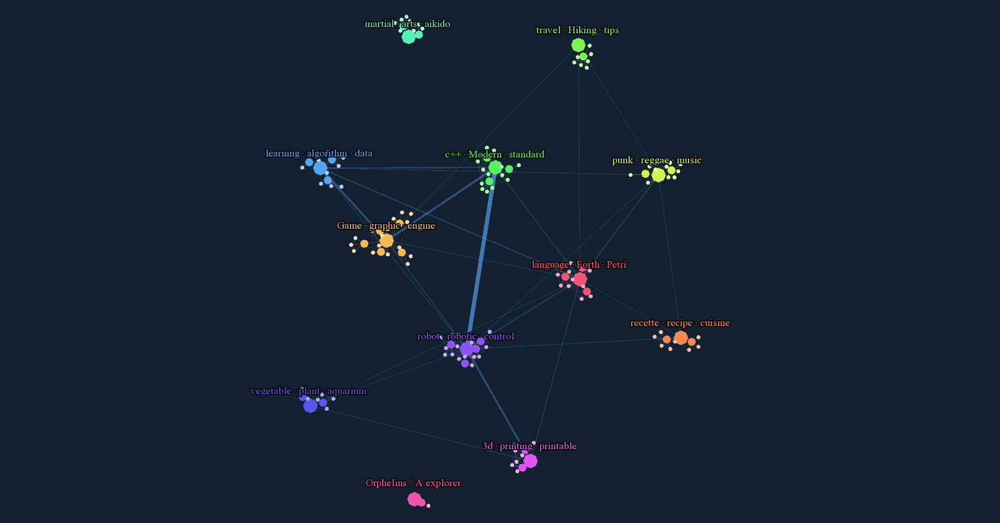

# 🏝️ Islanded Browser

This is a in gestation personal experience for the [Stigmee](https://github.com/stigmee) for displaying your (Firefox) browser bookmarks as an 3D island.

Notes:
- I wrote *bookmarks* not *tabs* because I never have 500 tabs opened in my browser but have so many unorganized bookmarks.
- I used Firefox, I do not use Chrome browser but I guess the process is identical.
- A [Youtube tutorial](https://youtu.be/_IjCipUK8Bk) shows an older version of the project.

## 📸 Screenshots

There is one program, `IslandedBrowser`, and what it draws depends on the JSON file it is given:

- a **Firefox bookmark file** (`private/bookmarks.json` written by step 1, or `bookmarks/example.json`) is drawn with its original Firefox folders (left): here, a few catch-all folders;
- an **organization file** (`private/organization.json` written by step 2, `organize.py`) is drawn as islands (right): one island per subject, communities inside each island, and blue rivers between related islands.

Both pictures show the same 118 bookmarks of [bookmarks/example.json](bookmarks/example.json):

| Firefox folders | Islands |
|:---:|:---:|
|  |  |
| `IslandedBrowser bookmarks/example.json` | `organize.py -i bookmarks/example.json`<br>then `IslandedBrowser private/organization.json` |

## 🚀 Quick start

Prerequisites: Python 3, GNU Make, g++, OpenMP and SFML 2.6.

```sh
git clone --recursive https://github.com/Lecrapouille/IslandedBrowser.git
cd IslandedBrowser

# 1. Export the Firefox bookmarks -> private/bookmarks.json
./bookmarks/firefox_export.py

# 2. Organize them in islands/communities -> private/organization.json
./bookmarks/organize.py

# 3. Build and draw the graph
make
./build/linux-gcc-normal/bin/IslandedBrowser private/organization.json   # islands
./build/linux-gcc-normal/bin/IslandedBrowser private/bookmarks.json      # your Firefox folders

# (optional) review private/organization.json: rename groups, edit the
# "constraints", then run step 2 again and redraw.

# 4. Write the files to load in Firefox    -> private/organized.html, private/organized.json
./bookmarks/firefox_import.py
```

Then, in Firefox (library window, Ctrl+Shift+O, *Import and Backup*):

- **safe**: *Import Bookmarks from HTML...* > `private/organized.html` adds everything in one new folder, your current bookmarks are kept;
- **replace**: *Backup...* first, then *Restore* > *Choose File...* > `private/organized.json` erases all your bookmarks and loads the islands.

All generated files contain personal data and go in `private/`, which git ignores.

## 🧪 Try it without your Firefox bookmarks

[bookmarks/example.json](bookmarks/example.json) is a Firefox backup of 118 public bookmarks (robotics, C++, graphics, machine learning, music, cooking, gardening, martial arts, 3D printing, travel, programming languages) spread in catch-all folders, as in a real collection. It replaces step 1:

```sh
make

# "Firefox folders" view: draw the Firefox file as it is.
./build/linux-gcc-normal/bin/IslandedBrowser bookmarks/example.json

# "Islands" view: organize it first (step 2), then draw the organization.
./bookmarks/organize.py -i bookmarks/example.json -o /tmp/example-organization.json
./build/linux-gcc-normal/bin/IslandedBrowser /tmp/example-organization.json
```

The `-o` option keeps the example away from `private/organization.json`, where your own organization lives. Without any argument, `IslandedBrowser` draws the first existing file among `private/organization.json`, `private/bookmarks.json` and `bookmarks/example.json`.

The full documentation of each step (file formats, how the groups are computed, constraints, options, troubleshooting) is in [doc/Pipeline.md](doc/Pipeline.md).

## 🔀 Pipeline

```
Firefox ──1──> private/bookmarks.json ──2──> private/organization.json ──3──> IslandedBrowser
   ^                                                  │
   └───────────────────────4──────────────────────────┘
                 private/organized.html  or  private/organized.json
```

| Step | Script | Output |
|------|--------|--------|
| 1. Export | `bookmarks/firefox_export.py` | Firefox tree read from `places.sqlite` (a copy, Firefox can stay open) |
| 2. Organize | `bookmarks/organize.py` | TF-IDF similarity, nearest neighbour graph, Louvain: islands > communities > bookmarks |
| 3. Draw | `IslandedBrowser` | force-directed layout, one color per island, rivers between related islands |
| 4. Import | `bookmarks/firefox_import.py` | the organization as Firefox bookmark files |

In the window: hover shows the title, a click opens the bookmark (a folder opens its first 15 bookmarks), wheel zooms, right drag pans. Keys: `Space` pause, `R` restart, `F` fit, `L` links, `N` names, `S` screenshot, `Esc` quit.

## 🧮 Algorithm

The force-directed layout (`src/ForceDirectedGraph.cpp`) follows Fruchterman and Reingold: every pair of vertices repels (K²/d), springs attract (strength × d²/K), a weak gravity keeps the islands together, and the displacements are bounded by a temperature that cools down so the layout stops. Springs are the tree edges (island > community > bookmark) and the similarity links; a link between two islands is 30 times weaker, so related islands get closer without merging. Each island starts in its own disc on a sunflower spiral. With 2500 bookmarks the layout converges in about 0.6 s (OpenMP).

Next steps: Voronoi cells around the communities, height maps for islands, 3D rendering.

## 📚 References

- Philipp Kindermann Youtube videos [Force-Directed Drawings (1/3)](https://youtu.be/WWm-g2nLHds)
- https://github.com/qdHe/Parallelized-Force-directed-Graph-Drawing
